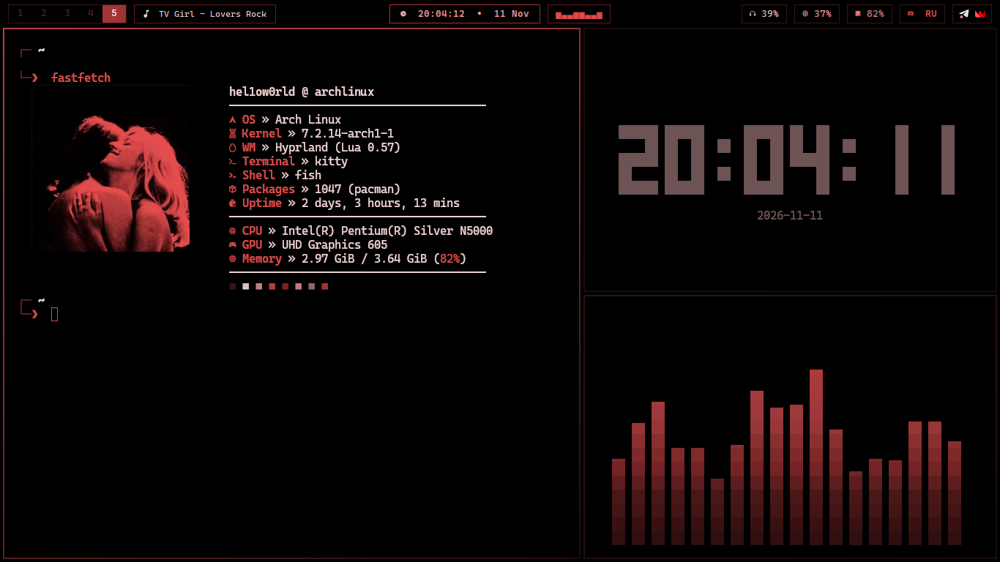

  # 🍷 𝐡𝐞𝐥𝟏𝐨𝐰𝟎𝐫𝐥𝐝

  

    <em>«Before you start to hate yourself...»</em>
  

  

    
    
    
  

  

 

  

---

### 🛠️ Tech Stack & Tools

  
  
  
  
  
  
  
  

---

### 📊 GitHub Stats

  
  

 

  Made with 🌹 inspired by <b>French Exit</b>

